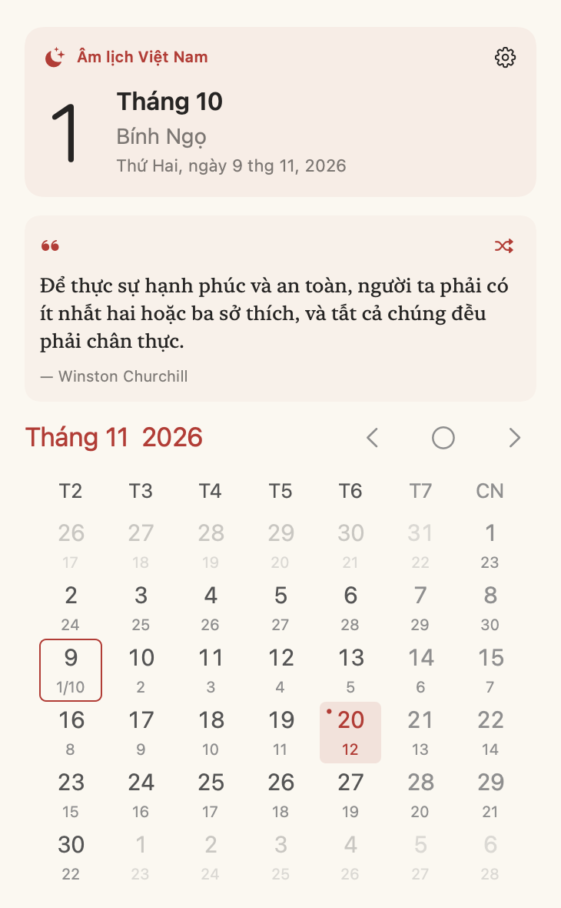
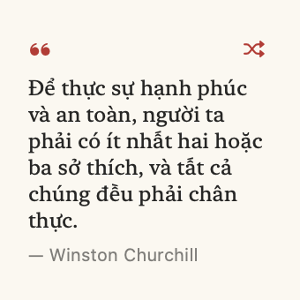

# Âm Lịch cho macOS

Ứng dụng âm lịch Việt Nam native, viết bằng SwiftUI + AppKit, với WidgetKit.
Đây là **fork từ [ZzzM/CalendarX](https://github.com/ZzzM/CalendarX)**, giữ lại
menu bar, lịch tháng, tùy chỉnh giao diện, phím tắt và nền tảng widget của dự án gốc.



## Tính năng

- Ngày âm ngay trên thanh menu, ví dụ `☾ 30/9`.
- Lịch tháng âm/dương song song, duyệt tháng và năm từ 1900 đến 2100.
- Tính sóc và tháng nhuận theo **UTC+7**, gồm các năm Việt Nam khác lịch Trung Quốc.
- Can Chi ngày, tháng, năm; Tết, giỗ Tổ, Đoan ngọ, Vu Lan, Trung thu và các ngày lễ Việt Nam.
- Widget ngày **nhỏ/vừa** và widget lịch tháng **lớn**, có nút tháng trước/sau và về hôm nay.
- **1.000 danh ngôn tiếng Việt offline**, thứ tự được xáo trộn; một câu cố định mỗi ngày.
- Nút **Shuffle** đổi câu ngay và lưu chung giữa app/widget; duyệt hết 1.000 câu trước khi lặp.
- Widget **Mỗi ngày một câu** cỡ nhỏ/vừa; widget ngày cỡ vừa cũng hiển thị danh ngôn.
- Widget ngày chuẩn bị sẵn các mốc nửa đêm trong 7 ngày để cập nhật khi app không mở.
- Giao diện tiếng Việt, sáng/tối theo hệ thống, màu sắc và ngày đầu tuần tùy chỉnh.
- Xem sự kiện Apple Calendar khi người dùng chủ động cho phép; mặc định tắt.
- Tính âm lịch hoàn toàn offline, không cần tài khoản hoặc API.

## Chạy bản build cục bộ

Yêu cầu **macOS 14+**. Bản build trên máy phát triển nằm tại `dist/AmLich.app`.

1. Mở `dist/AmLich.app`. App hiển thị ngày âm trên thanh menu; bấm để mở lịch.
2. Bấm bánh răng hoặc bấm phải lên ngày âm để mở cài đặt.
3. Thêm widget: **nhấp phải desktop → Sửa tiện ích / Edit Widgets → Âm Lịch**.
4. Chọn widget ngày nhỏ/vừa, **Mỗi ngày một câu**, hoặc lịch tháng lớn. Nhấp phải widget → Sửa tiện ích
   để đổi màu, ngôn ngữ, ngày đầu tuần và các tùy chọn của lịch tháng.
5. Bấm vào widget ngày để mở app. Nút mũi tên trong widget tháng đổi tháng trực tiếp.

Có thể kéo app vào thư mục Applications để giữ vị trí ổn định. Bản hiện tại được
ký Apple Development cho máy phát triển; chưa phải bản Developer ID đã notarize
để phát hành công khai cho các máy khác.

Phím tắt khi mở lịch: ← / → đổi tháng, ↑ / ↓ đổi năm, Space về hôm nay, Esc quay lại/đóng.

## Build từ source

Yêu cầu Xcode 16+ và Swift 6. Tên project/target `CalendarX` được giữ để dễ đồng bộ upstream.

```sh
git clone https://github.com/7inh/AmLich.git
cd AmLich
swift test --package-path CalendarXLib
open CalendarX.xcodeproj
```

Trong **cả ba target** CalendarX, CalendarXWidget, CalendarXIntentExtension,
chọn Automatically manage signing và Apple Development team của bạn.
Nếu fork sang team khác, chọn team mới và đổi bundle identifier của ba target
trong project khi cần. App Group tự dùng prefix team qua build setting
`AMLICH_APP_GROUP=$(DEVELOPMENT_TEAM).vn.7inh.amlich`; mã dùng chung đọc tên này
qua Info.plist, không chứa team ID cố định. Đây là định dạng App Group riêng cho
macOS, [được Apple hỗ trợ mà không cần đăng ký group trên portal](https://developer.apple.com/documentation/xcode/accessing-app-group-containers).

Hoặc build và đóng gói trên Terminal với team đã cấu hình:

```sh
TEAM_ID=YOUR_TEAM_ID scripts/build-macos.sh
```

Kết quả: `dist/AmLich.app` và `dist/AmLich-0.2.2-macOS.zip`.
Nếu Xcode báo Mac chưa được đăng ký trong team, đăng ký máy trong Xcode trước.
Chạy `scripts/build-macos.sh` không truyền TEAM_ID chỉ biên dịch không ký mã,
phù hợp CI; muốn chạy widget cần bản đã ký bằng team của bạn.

## Kiểm chứng

11 XCTest kiểm tra shuffle không lặp, tính ổn định giữa app/widget, lưu lựa chọn,
đổi ngày (gồm DST), nguồn dữ liệu và Tết (gồm 1985 và 2007), tháng nhuận 2023/2025,
Trung thu, múi giờ, ngày lễ và tính liên tục mỗi ngày trong giai đoạn 1900–2100.
Ảnh preview được render trực tiếp từ SwiftUI trong `artifacts/previews`.
Với build Debug có thể tái tạo ảnh bằng:

```sh
build/DerivedData/Build/Products/Debug/AmLich.app/Contents/MacOS/AmLich --render-previews "$PWD/artifacts/previews"
build/DerivedData/Build/Products/Debug/AmLich.app/Contents/MacOS/AmLich --render-previews "$PWD/artifacts/previews" --dark
```

Ngày dương “hôm nay” theo múi giờ Mac; các mốc sóc và tháng âm luôn tính theo UTC+7.
Trước 1968, app chiếu quy tắc hiện đại về quá khứ, không mô phỏng lịch lịch sử từng vùng.
Các nhãn lễ là ngày văn hóa cố định, không phải lịch nghỉ bù/làm bù do Nhà nước công bố.
Thao tác đổi tháng áp dụng chung cho các widget tháng trên cùng máy và tự về hôm nay
khi sang ngày mới. Màu/ngôn ngữ của mỗi widget tháng được cấu hình riêng.
Thời điểm macOS hiển thị lại widget vẫn do WidgetKit quản lý.

## Danh ngôn và Shuffle

Bản 0.2.0 đóng gói 1.000 câu tiếng Việt ngắn từ
[trananhtung/danh-ngon](https://github.com/trananhtung/danh-ngon), khóa theo commit
`d41ef22a98435fd3cbd75298463872d038c658e4`. Bộ lọc loại câu tiếng Anh, câu quá dài,
câu trùng và một số nội dung không hợp lịch ngày. Bản dịch và tên tác giả theo
nguồn tổng hợp, chưa được đối chiếu từng câu; liên kết nguồn được giữ trong bộ dữ liệu.

Thứ tự Fisher–Yates dùng seed cố định nên app và các tiến trình widget có cùng
thứ tự, không cần máy chủ. Ngày được tính theo múi giờ Mac; 0 giờ chọn câu tiếp theo.
Bấm biểu tượng Shuffle (hai mũi tên chéo) trong app hoặc widget để tiến thêm một
câu. Lựa chọn được lưu trong App Group và WidgetKit được yêu cầu cập nhật.
Các ngày sau tiếp tục từ vị trí mới. Không chọn ngẫu nhiên lại khi mở app.

Để tái tạo bộ dữ liệu offline đã dùng:

```sh
python3 scripts/import-quotes.py
```

Widget **Mỗi ngày một câu** có cỡ nhỏ/vừa. Widget **Ngày âm lịch** cỡ vừa đặt câu
bên cạnh ngày âm; cỡ nhỏ giữ bố cục ngày âm. Widget lịch tháng giữ bố cục lịch.



## Nguồn gốc và giấy phép

**AGPL-3.0**, giữ nguyên [LICENSE](LICENSE) từ CalendarX. Khi phân phối bản sửa đổi,
cung cấp mã nguồn tương ứng theo giấy phép. Phần tính sóc tham khảo thuật toán Meeus
và mã MIT của astronomia; xem [THIRD_PARTY_NOTICES.md](THIRD_PARTY_NOTICES.md).
Đã tắt feed cập nhật của upstream để bản fork không tự chuyển lại CalendarX.
